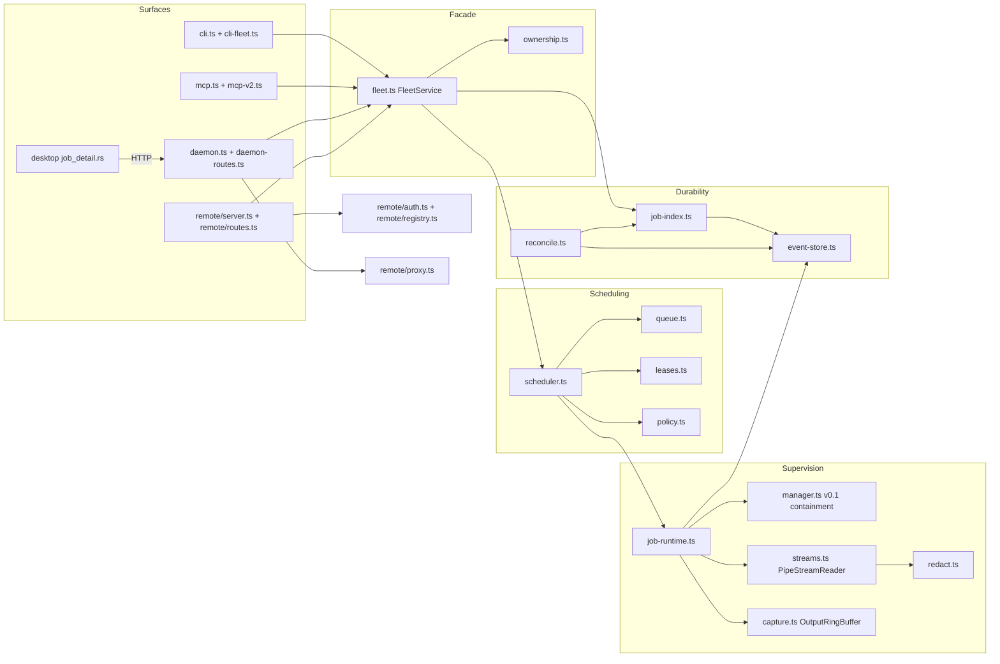
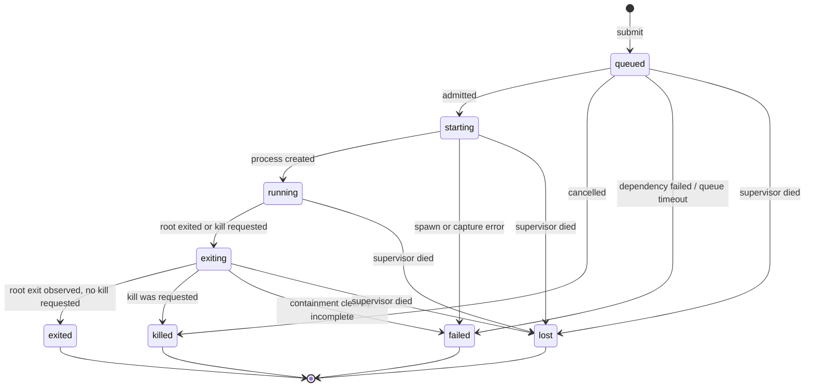
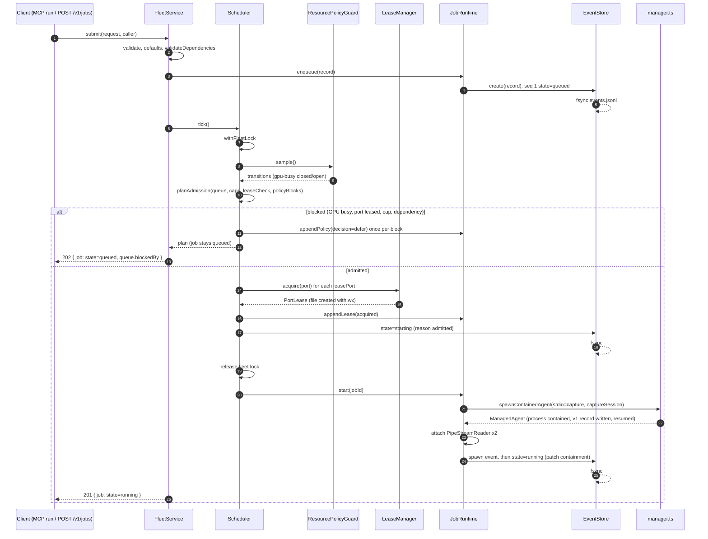
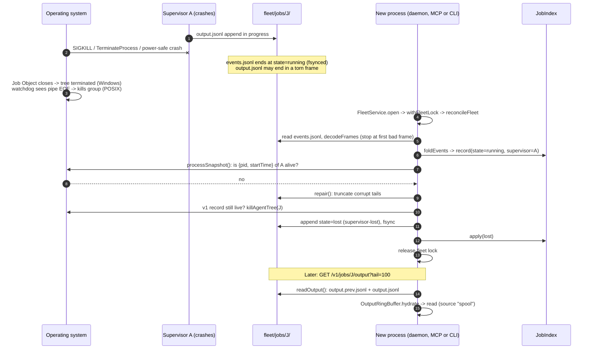
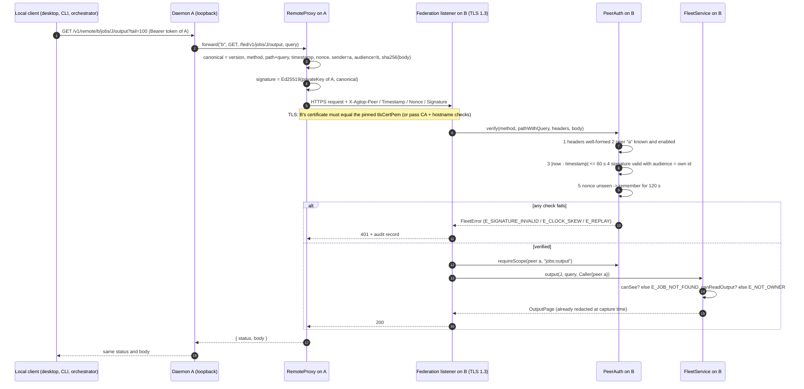

# agtop Fleet v0.2: architecture

Status: design complete, implementation not started. Base: `master` at `d516dcb`.
Companion documents: [contracts](fleet-contracts.md) (normative types and routes), [ADRs](fleet-adrs.md), [threat model](fleet-threat-model.md), [acceptance](fleet-acceptance.md).

## 1. What v0.2 adds

v0.1 can start, find, contain and stop agent process trees, but a background job is a black box: its output is discarded, its history disappears when it exits, nothing stops ten agents from starting ten GPU jobs at once, and one machine cannot see another. Fleet v0.2 adds five things on top of the unchanged v0.1 containment engine:

1. **A durable job record and state machine** (`JobRecordV2`, eight states) backed by an append-only, checksummed event log per job.
2. **Bounded output capture**: stdout and stderr through non-blocking pipes into a 1 MiB ring per job, with a rotating on-disk tail so output survives a supervisor crash.
3. **Default-on secret redaction** before any byte reaches memory, disk, HTTP or MCP.
4. **Cooperative admission control**: priority queue with aging and dependencies, concurrency caps, advisory port leases, and GPU/NPU/memory guards with hysteresis. Running jobs are never suspended.
5. **Federation**: read and control another machine's daemon through Ed25519-signed requests over TLS with per-peer scopes.

Non-goals for v0.2: PTY capture (v0.3, behind `AGTOP_PTY=1`), interactive stdin, preemption or throttling of running jobs, a sandbox, multi-user isolation on one machine, automatic TLS certificate generation, and peer discovery.

## 2. Processes, modules and dataflow

### 2.1 Supervisors

agtop has no single long-lived server. Each of these processes can supervise jobs, exactly as in v0.1:

| Supervisor | Lifetime | Jobs it supervises |
| --- | --- | --- |
| `agtop mcp` (one per agent session) | The agent session | Jobs started by that session's `run` tool |
| `agtop daemon` / `agtop ui` | Until stopped | Jobs submitted with `POST /v1/jobs`, including jobs submitted by remote peers |
| `agtop run` | One foreground job | One v0.1 job; no fleet record |

A **supervisor** is the process that created a job's pipes. It is the only process that can read that job's live output and the only writer of that job's event log. When a supervisor dies, the operating system kills its jobs (Job Object kill-on-close on Windows; the watchdog or cgroup on POSIX), so a job never outlives its capture.

Everything shared between supervisors is a file under `<stateDir>/fleet/`: event logs, output spools, port leases, the admission lock and the policy. Any process run by the same OS user can read them, which is how the daemon, the desktop and the CLI show jobs that an MCP session supervises.

### 2.2 Module map



Layering rule: an arrow is an allowed import. Surfaces import `fleet.ts` and `ownership.ts` (plus `remote/*` for the daemon); nothing below the facade imports a surface; `queue.ts` and `redact.ts` import nothing but types.

| Module | Responsibility | Must not |
| --- | --- | --- |
| `manager.ts` | v0.1 spawn, containment, kill. v0.2 adds only `stdio: "capture"`. | Know about events, queues or leases |
| `event-store.ts` | Frame encoding, per-job append-only logs, output segment rotation, tolerant reads | Interpret events or scan processes |
| `job-index.ts` | Fold events into `JobRecordV2`; in-memory map; v1 migration view | Write anything |
| `reconcile.ts` | Fleet lock, supervisor liveness, `lost` detection, tail repair, retention | Re-adopt a job |
| `streams.ts` | Drain one pipe without backpressure; chunking; UTF-8 boundaries; flush timing | Buffer unboundedly, block the child |
| `redact.ts` | Streaming, boundary-safe redaction | Use unbounded or nested quantifiers |
| `capture.ts` | Bounded ring, eviction, read queries, truncation info | Touch disk |
| `job-runtime.ts` | One supervisor's jobs: state transitions in the right order, wiring reader → ring + log | Decide admission |
| `queue.ts` | Pure ordering and admission planning | Do I/O |
| `leases.ts` | Advisory port leases as exclusive files | Bind ports |
| `policy.ts` | Thresholds, hysteresis, policy file | Signal or suspend processes |
| `scheduler.ts` | One admission pass under the fleet lock | Hold the lock across a spawn |
| `fleet.ts` | The single API for surfaces; routing of output reads (ring vs. spool) | Leak data past `ownership.ts` |
| `remote/*` | Peer identity, request signing, federation listener, outbound proxy | Share code paths with bearer auth |

### 2.3 Output dataflow

```
child stdout ─ pipe ─► PipeStreamReader ─► SecretRedactor ─► chunker (UTF-8 boundary, 4–64 KiB, 100 ms tick)
                                                                  │  onChunk(bytes)
                                                                  ▼
                                              JobEventWriter.appendOutput  ── assigns seq + offset
                                                   │                 │
                                    output.jsonl (no fsync,          ▼
                                    rotates at ringBytes)     OutputRingBuffer.push (1 MiB, evicts oldest)
                                                                     │
                       GET /v1/jobs/:id/output, MCP output, agtop logs ◄── OutputRingBuffer.read
```

Redaction is the first stage after the pipe. Unredacted bytes exist only in the redactor's carry (at most the last 1 KiB per stream, in memory).

## 3. Job state machine



State meanings:

| State | Meaning |
| --- | --- |
| `queued` | Recorded durably; no process exists. Every job starts here, including immediate-admission jobs. |
| `starting` | Admitted: leases are held and the slot is counted. The process is being created. |
| `running` | The root process exists, is contained, and its v1 record is written. |
| `exiting` | The root has exited or agtop is terminating the tree. Pipes are draining and descendants are being cleaned up. |
| `exited` | The root exited on its own. `exitCode` may be nonzero. |
| `failed` | agtop could not start the job or could not finish cleaning it up. Not used for a nonzero exit code. |
| `killed` | agtop terminated the job on request: `kill`, `cleanup`, timeout, cancel, or supervisor shutdown. |
| `lost` | The supervisor died before recording a terminal state. The outcome of the job is unknown; captured output up to the crash is kept. |

### 3.1 Transition table

Every transition is one `StateEvent`, fsynced, written by the job's supervisor (the `lost` rows are written by a reconciler). Any transition not listed is illegal and `JobEventWriter.appendState` throws.

| # | From → To | `reason` | Trigger | Actions, in order |
| --- | --- | --- | --- | --- |
| 1 | — → `queued` | `submitted` | `FleetService.submit` validated the request | Create job directory; write seq 1 with the full record; fsync |
| 2 | `queued` → `starting` | `admitted` | Scheduler plan admits the job, or `admission: "immediate"` | Inside the fleet lock: acquire leases (`LeaseEvent acquired` each), append state, fsync, release lock |
| 3 | `starting` → `running` | `spawned` | `spawnContainedAgent` resolved | Attach a `PipeStreamReader` to each stream; `SpawnEvent`; state with patch `{ containment, startedAt }`; start the `timeoutMs` timer |
| 4 | `starting` → `failed` | `capture-error` | `CaptureProvider.open` threw | State with patch `{ error, exitedAt }`; `hooks.beforeTerminal` (leases released) precedes the state event |
| 5 | `starting` → `failed` | `spawn-error` | `spawnContainedAgent` rejected | Dispose the capture session; then as row 4 |
| 6 | `running` → `exiting` | `root-exited` | `ManagedAgent.exited` settled and no kill is pending | State; `reader.notifyExit()` on both readers |
| 7 | `running` → `exiting` | `kill-requested`, `timeout`, `cleanup`, `supervisor-shutdown` | `JobRuntime.kill`, the timeout timer, MCP `cleanup`, or `FleetService.close` | State **first**, then `ManagedAgent.terminate()`; then `notifyExit()` |
| 8 | `exiting` → `exited` | `root-exited` | Both readers `done`; entered `exiting` by row 6; no `kill.request` marker | `ExitEvent`; `hooks.beforeTerminal`; state with patch `{ exitCode, signal, exitedAt, lastSeq, outputBytes }`; close writer; `hooks.afterTerminal` |
| 9 | `exiting` → `killed` | the reason of row 7, or the marker's reason | Both readers `done`; entered by row 7, or a `kill.request` marker exists | As row 8 |
| 10 | `exiting` → `failed` | `containment-error` | `terminate()` reported `failedPids` or `errors` | As row 8, with `error` set to the joined errors |
| 11 | `queued` → `killed` | `cancelled`, `cleanup`, `supervisor-shutdown` | `JobRuntime.kill` on a queued job, or a `kill.request` marker seen by the scheduler | State with patch `{ exitedAt }`; `hooks.afterTerminal` |
| 12 | `queued` → `failed` | `dependency-failed`, `queue-timeout` | Scheduler plan | State with patch `{ error, exitedAt }`; `hooks.afterTerminal` |
| 13 | any non-terminal → `lost` | `supervisor-lost` | Reconciler proved the supervisor dead | See section 4 |

Notes:

- A kill that arrives while a job is `starting` waits for row 3, 4 or 5 to complete and then proceeds from the resulting state. There is no `starting` → `killed`.
- `policy-rejected` is reserved in `JobStateReason` and is never written in v0.2.
- Row 7 writes the state event before terminating so that a crash between the two leaves evidence that the kill was intended.
- A job killed through the v0.1 paths (`agtop kill`, `POST /v1/agents/:id/kill`) has no marker and ends as `exited` with whatever exit code the OS reports. Use the v0.2 kill paths to get `killed`.
- `timeoutMs` is measured from the `running` event.
- Row 8/9 ordering matters: leases are released (and `LeaseEvent released` written) before the terminal event, so a lease is never held by a job that is durably terminal.

### 3.2 Illegal transitions (must be rejected)

`queued → running` (must pass through `starting`), `queued → exiting`, `queued → exited`, `starting → exiting`, `starting → killed`, `starting → exited`, `running → exited`, `running → killed`, `running → failed`, `running → queued`, any transition out of `exited`, `failed`, `killed` or `lost`, and any self-transition.

## 4. Restart reconciliation

`reconcileFleet` runs inside `FleetService.open`, which every daemon, MCP server and fleet CLI command calls at startup. It runs under the fleet lock, so concurrent starts are serialized.

For each directory in `fleet/jobs/`:

1. Read `events.jsonl` (tolerant read, no truncation yet) and fold it. A directory with no valid seq 1 is ignored and left on disk.
2. Terminal job → nothing to reconcile. Apply retention (step 6).
3. Non-terminal job whose `supervisor` is alive (`supervisorAlive`: same PID **and** same creation time in the process snapshot) → leave it alone. It belongs to another running process. Never truncate its files.
4. Non-terminal job whose supervisor is this process → impossible at startup; skip.
5. Non-terminal job whose supervisor is dead:
   1. `store.repair(jobId)`: truncate the corrupt tail of each of the three files, if any.
   2. If the state is `starting`, `running` or `exiting` and a v1 record for the job still exists and `isStaleJob(v1)` is false, live members remain (for example a POSIX watchdog has not finished). Call `killAgentTree(jobId)` and collect `killedPids`. Errors are recorded in the event's `detail`, not thrown.
   3. Reopen the log and append `state: "lost"`, reason `supervisor-lost`, patch `{ exitedAt: now, exitCode: null, lastSeq, outputBytes }` where the counters come from `store.readOutput(jobId)`, and `detail` naming the previous state. fsync.
   4. Release the job's leases by deleting every `fleet/leases/<port>.json` whose `jobId` equals this job. `reconcile.ts` does this with plain file operations and does not import `leases.ts`.
6. Retention: delete terminal job directories whose `exitedAt` is older than `RETENTION_HOURS`, then the oldest terminal jobs beyond `RETENTION_MAX_JOBS`. A job that another queued job lists in `dependsOn` is kept.

A job is never re-adopted. Its pipes died with its supervisor, so there is nothing to attach to; and on Windows the Job Object's kill-on-close has already terminated the tree. `lost` therefore means "we stopped watching", and reconciliation makes sure nothing is left running unwatched.

If the process snapshot cannot be taken, reconciliation marks nothing as lost (unknown is never treated as dead), logs one line to stderr, and continues.

## 5. Sequence diagrams

### 5.1 Submission → admission → spawn



### 5.2 High-volume output → redaction → ring overflow → live tail

```mermaid
sequenceDiagram
  autonumber
  participant P as Child process
  participant K as OS pipe
  participant D as PipeStreamReader
  participant X as SecretRedactor
  participant W as JobEventWriter
  participant B as OutputRingBuffer
  participant H as HTTP / MCP reader
  loop every data event (never paused, never awaited)
    P->>K: write (blocking on its side)
    K->>D: data (up to 64 KiB)
    D->>X: push(bytes, "data")
    X-->>D: released bytes (all but the last 1 KiB; matches replaced, none split)
    D->>D: pending >= 4 KiB? cut at UTF-8 boundary, max 64 KiB
    D->>W: onChunk -> appendOutput(stream, bytes)
    W->>W: seq = ++lastSeq, offset = stream bytes so far
    W->>W: write frame to output.jsonl (no fsync); rotate at ringBytes
    W->>B: push(chunk)
    B->>B: over 1 MiB or 4096 chunks: evict oldest (stderr reserve 64 KiB), release buffer
  end
  Note over D,X: every 100 ms: push(empty, "tick") releases through the last newline, even mid-burst
  H->>B: read({ stream: stdout, tail: 100, since: 0 })
  B-->>H: chunks (first one trimmed to the line boundary) + truncation { firstDroppedSeq, lastDroppedSeq, droppedBytes }
  P->>K: exit
  D->>X: push(empty, "eof") on end, or 2 s after exit if a descendant holds the pipe
  D->>W: final chunk (may end mid code point)
```

### 5.3 Supervisor crash → restart → recovery



### 5.4 Federated query with signature and scope checks



`list` uses scope `jobs:list` and filters with `canSee`; `kill` uses `jobs:kill` (own jobs) or `jobs:kill-any`, checks `canKill`, writes a `peer-kill` audit record, and then follows transition row 7.

## 6. Implementation plan: 5 waves, 25 units

Rules for the orchestrator:

- A unit starts only when every unit in its **Needs** column is merged into the wave integration branch. Units with satisfied needs run in parallel.
- A unit writes only the files in its **Writes** column. Each unit stays within 6 files and 400 changed lines. Test files are listed and count.
- The shared files have exactly one owning unit per wave (table 6.6). Nobody else touches them.
- Every unit must leave `bun run check` and `bun test` green on Windows, Linux and macOS.

### 6.1 Wave 1 — durable foundations

| Unit | Writes | Needs | Contract |
| --- | --- | --- | --- |
| 1.1 Types, errors, state table | `src/types.ts`, `src/fleet-errors.ts`, `src/job-state.ts`, `test/fleet-types.test.ts` | — | Contracts 2, 6.2 (seam types), 7.1 (types), 14 |
| 1.2 Event store | `src/event-store.ts`, `test/event-store.test.ts` | 1.1 | Contracts 1.1, 4 |
| 1.3 Job index | `src/job-index.ts`, `test/job-index.test.ts` | 1.2 | Contracts 2.2, 5 |
| 1.4 Redactor | `src/redact.ts`, `test/redact.test.ts` | 1.1 | Contracts 6.1 |
| 1.5 Private files and audit log | `src/secure-fs.ts`, `src/audit.ts`, `test/secure-fs.test.ts`, `test/audit.test.ts` | 1.2, 1.4 | Contracts 15 |

### 6.2 Wave 2 — capture

| Unit | Writes | Needs | Contract |
| --- | --- | --- | --- |
| 2.1 Ring buffer | `src/capture.ts`, `test/capture.test.ts` | 1.2 | Contracts 2.4, 6.3 |
| 2.2 Pipe reader and POSIX provider | `src/streams.ts`, `test/streams.test.ts` | 1.4 | Contracts 6.2; this document 7.1, 7.3 |
| 2.3 Windows pipe provider | `src/windows-pipes.ts`, `src/windows.ts`, `test/windows-pipes.test.ts` | 2.2 | Contracts 6.4; this document 7.2 |
| 2.4 Job runtime | `src/job-runtime.ts`, `src/manager.ts`, `src/watchdog.ts`, `test/job-runtime.test.ts` | 1.3, 2.1, 2.2, 2.3 | Contracts 7.1, 7.2, 8.6; this document 3 |
| 2.5 Reconciliation | `src/reconcile.ts`, `test/reconcile.test.ts` | 1.3, 1.5 | Contracts 7.3, 8.5; this document 4 |

### 6.3 Wave 3 — admission

| Unit | Writes | Needs | Contract |
| --- | --- | --- | --- |
| 3.1 Port leases | `src/leases.ts`, `test/leases.test.ts` | 2.5 | Contracts 8.1 |
| 3.2 Policy guard | `src/policy.ts`, `test/policy.test.ts` | 1.5 | Contracts 2.5, 8.2 |
| 3.3 Queue planner | `src/queue.ts`, `test/queue.test.ts` | 1.1 | Contracts 8.3 |
| 3.4 Scheduler | `src/scheduler.ts`, `test/scheduler.test.ts` | 2.4, 3.1, 3.2, 3.3 | Contracts 8.4 |
| 3.5 Fleet facade and ownership | `src/fleet.ts`, `src/ownership.ts`, `test/fleet.test.ts`, `test/ownership.test.ts` | 3.4 | Contracts 8.7 |

### 6.4 Wave 4 — surfaces

| Unit | Writes | Needs | Contract |
| --- | --- | --- | --- |
| 4.1 HTTP routes | `src/daemon-routes.ts`, `src/daemon.ts`, `test/daemon-fleet.test.ts` | 3.5 | Contracts 9.1, 9.2, 9.4 |
| 4.2 MCP v2 and skill | `src/mcp-v2.ts`, `src/mcp.ts`, `skills/agtop/SKILL.md`, `test/mcp-v2.test.ts`, `test/docs.test.ts` | 3.5 | Contracts 10 |
| 4.3 CLI | `src/cli-fleet.ts`, `src/cli.ts`, `test/cli-fleet.test.ts` | 3.5 | Contracts 16 |
| 4.4 Desktop job detail | `desktop/src/job_detail.rs`, `desktop/src/model.rs`, `desktop/src/client.rs`, `desktop/src/ui.rs`, `desktop/src/main.rs` | 3.5 (contract only) | Contracts 12 |
| 4.5 Library exports and release plumbing | `src/index.ts`, `package.json`, `scripts/mcp-smoke.ts`, `README.md` | 4.1, 4.2, 4.3 | This document 6.7 |

### 6.5 Wave 5 — federation and release gates

| Unit | Writes | Needs | Contract |
| --- | --- | --- | --- |
| 5.1 Peer registry and `agtop peers` | `src/remote/registry.ts`, `src/cli-peers.ts`, `src/cli.ts`, `test/peer-registry.test.ts` | Wave 4 | Contracts 11.1, 16 |
| 5.2 Request signing | `src/remote/auth.ts`, `test/peer-auth.test.ts` | 5.1 | Contracts 11.2 |
| 5.3 Outbound proxy and remote routes | `src/remote/proxy.ts`, `src/remote/routes.ts`, `test/remote-proxy.test.ts` | 5.2 | Contracts 9.3, 11.4 |
| 5.4 Federation listener | `src/remote/server.ts`, `src/daemon.ts`, `test/federation.test.ts` | 5.3 | Contracts 11.3 |
| 5.5 Acceptance gates and evals | `test/fleet-acceptance.test.ts`, `scripts/bench-fleet.ts`, `evals/agtop/read-job-output.json`, `evals/agtop/queue-heavy-job.json`, `evals/agtop/port-lease-conflict.json`, `evals/agtop/foreign-output.json` | 5.4 | [Acceptance](fleet-acceptance.md) |

### 6.6 Shared-file ownership

| File | Wave 1 | Wave 2 | Wave 3 | Wave 4 | Wave 5 |
| --- | --- | --- | --- | --- | --- |
| `src/types.ts` | 1.1 | — | — | — | — |
| `src/index.ts` | — | — | — | 4.5 | — |
| `src/daemon.ts` | — | — | — | 4.1 | 5.4 |
| `src/mcp.ts` | — | — | — | 4.2 | — |
| `src/cli.ts` | — | — | — | 4.3 | 5.1 |
| `package.json` | — | — | — | 4.5 | — |
| `src/manager.ts`, `src/watchdog.ts` | — | 2.4 | — | — | — |
| `src/windows.ts` | — | 2.3 | — | — | — |
| `README.md` | — | — | — | 4.5 | — |
| `skills/agtop/SKILL.md`, `test/docs.test.ts` | — | — | — | 4.2 | — |
| `src/registry.ts`, `bun.lock`, `tsconfig*.json`, `.github/workflows/ci.yml` | never edited | | | | |

Because all v0.2 types land in Unit 1.1, a later unit that needs a type change must stop and escalate; it must not declare a local variant.

### 6.7 Unit 4.5 details

- `src/index.ts`: add `export { FleetService } from "./fleet.js";`, `export type { SubmitJobRequest, JobView } from "./fleet.js";`, `export type { Caller } from "./ownership.js";`, `export { FleetError } from "./fleet-errors.js";`, `export { truncationMarker, renderOutputText } from "./capture.js";`. The existing `export type * from "./types.js"` already exports the new types.
- `package.json`: `version` to `0.2.0`; add script `"bench:fleet": "bun scripts/bench-fleet.ts"`. No dependency changes.
- `scripts/mcp-smoke.ts`: add one captured job (`run` a command that prints a known line, `wait`, `output`, assert the line) and one cross-session denial check.
- `README.md`: change the Fleet section's status line from "in progress" to "available" and remove nothing else.

## 7. Reference capture patterns from the spike

The spike lives on branch `spike/fleet-v0.2-capture` under `spike/` (throwaway; never merged). Units 2.1–2.3 should read `spike/fleet-spike.ts` and `spike/win-job.ts` as working references; the contracts are normative where they differ.

### 7.1 Reader pattern (Unit 2.2)

```ts
// One reader per stream. The handler never awaits and never pauses the stream.
source.on("data", (data: Buffer) => {
  const safe = redactor ? redactor.push(data, "data") : data;       // all but the last 1 KiB
  if (safe.length) { pending.push(safe); size += safe.length; }
  if (size >= MIN_CHUNK_BYTES) emit(false);                         // data-driven: keep a short tail pending
});
const timer = setInterval(() => {                                    // latency bound, fires even mid-burst
  const safe = redactor ? redactor.push(EMPTY, heldTooLong() ? "eof" : "tick") : EMPTY;
  if (safe.length) { pending.push(safe); size += safe.length; }
  emit(true);                                                        // tick-driven: flush everything on a boundary
}, FLUSH_TICK_MS);
timer.unref();
source.once("end", finish); source.once("close", finish); source.once("error", finish);

function emit(force: boolean, eof = false) {
  let buffer = Buffer.concat(pending); pending = []; size = 0;
  while (buffer.length) {
    const cut = eof && buffer.length <= MAX_CHUNK_BYTES ? buffer.length
      : utf8Boundary(buffer, Math.min(buffer.length, MAX_CHUNK_BYTES));
    if (cut === 0 || (!force && cut === buffer.length && cut < MIN_CHUNK_BYTES)) break;
    options.onChunk(buffer.subarray(0, cut), now());
    buffer = buffer.subarray(cut);
  }
  if (buffer.length) { pending = [buffer]; size = buffer.length; }
}
```

What the spike established:

- **No backpressure is the whole trick.** The emitter child writes with blocking `writeSync`; it would deadlock the moment the parent stopped reading. With an always-flowing `data` handler, 10 MiB passed in about 150 ms and 20 concurrent 2 MiB jobs completed without a stall.
- **Flush on a timer, not on idleness.** The first spike version flushed only when a stream had been idle for 100 ms. A child that printed a short line every 5 ms was never idle, so its output reached the ring only every 4 KiB. The fix is the unconditional 100 ms tick above.
- **Chunks arrive split anywhere**: mid-line, mid-code-point, mid-secret. `utf8Boundary` and the redactor carry handle the last two; nothing depends on lines.
- **Do the work synchronously in the handler.** Redaction, framing and one `writeSync` per chunk together cost under 15 ms per MiB on the test host (10 MiB end to end in about 150 ms, child startup included). A queue between the handler and the disk would need its own bound and would only move the drop point.

### 7.2 Windows: named pipes inside the Job Object launch (Unit 2.3)

v0.1 starts Windows jobs with `CreateProcessW` (suspended, `PROC_THREAD_ATTRIBUTE_JOB_LIST`), not with `child_process.spawn`, so Node cannot create the pipes. The pattern that works under both Bun and Node:

1. For each of stdout and stderr, create a **named-pipe server** with `net.createServer().listen("\\\\.\\pipe\\agtop-<jobId>-<stream>-<uuid>")` and wait for `listening`. libuv creates the instance with overlapped I/O, so reads are event-loop driven and never block a thread.
2. Open the **client end** synchronously with Koffi: `CreateFileW(name, GENERIC_WRITE (0x40000000), FILE_SHARE_READ | FILE_SHARE_WRITE (3), &sa, OPEN_EXISTING (3), 0, NULL)` where `sa` is a 24-byte `SECURITY_ATTRIBUTES` (`nLength = 24` at offset 0, `bInheritHandle = 1` at offset 16). Flags 0: the child gets an ordinary synchronous handle, which is what console programs expect. Check the result against both `NULL` and `INVALID_HANDLE_VALUE` (`0xFFFFFFFFFFFFFFFF`).
3. Open `NUL` the same way with `GENERIC_READ (0x80000000)` for the child's stdin.
4. Pass the three handles to `launch` (contracts 6.4): `STARTF_USESTDHANDLES (0x100)`, a 3-entry `PROC_THREAD_ATTRIBUTE_HANDLE_LIST (0x20002)` next to the existing `JOB_LIST (0x2000d)` entry (attribute count 2), `bInheritHandles = TRUE`.
5. **Immediately after `CreateProcessW` returns, close all three handles in the parent** (`releaseChildEnds`). If the daemon keeps a write end open, the reader never sees EOF. This is the single most likely bug.
6. The server's `connection` event delivers a `net.Socket`; call `server.close()` in that handler so the pipe name accepts no second client. The connection is made by step 2, not by the child, so the event fires on a later loop turn whether or not a process exists yet. `CaptureProvider.open()` performs steps 1–3 and awaits both connection events before it resolves; `attach()` is then synchronous and just returns the two sockets.
7. EOF arrives as `end` when the last write handle closes, which is when the last process holding it exits. The existing exit poll calls `TerminateJobObject` when the root exits, so descendants cannot hold the pipe open for long; `DRAIN_GRACE_MS` covers the rest.

Observed on the test host: identical throughput and latency to Node's own pipes (table in section 8), correct EOF, correct exit codes, and the child died with the daemon when the daemon was killed with `TerminateProcess`.

Failure handling: if `CreateFileW` fails with `ERROR_PIPE_BUSY` (231) another process connected to the pipe name first; fail the launch with reason `capture-error`. Pipe names contain a random UUID and are never logged before the client end is open.

### 7.3 POSIX pipes (Unit 2.2)

- Use Node's own pipes: `spawn("/bin/sh", [...], { stdio: ["ignore", "pipe", "pipe", "pipe"] })`. fd 3 remains the launch gate; attach the readers before writing `go\n` to it.
- The child of the launcher inherits fds 1 and 2 across `exec "$@"`, so the harness writes straight to the pipes. Descendants inherit them too: a daemonized grandchild that keeps stdout open delays `end` indefinitely. That is why exit is detected from the process (`ManagedAgent.exited`), never from pipe EOF, and why `notifyExit()` bounds the drain.
- A child that receives `EPIPE`/`SIGPIPE` after the supervisor dies usually exits; the watchdog kills the rest. Do not rely on it.
- The watchdog helper and the cgroup launcher are unaffected: they use their own fd 3 pipe.
- The spike ran on Windows only (the development host). The POSIX provider is plain `child_process` pipes, which the spike also exercised on Windows as the `node` provider; Linux and macOS runs of the same reader come from CI when Unit 2.2 lands. Treat any POSIX-specific claim above as design intent to be verified by that unit's tests.

### 7.4 Ring buffer (Unit 2.1)

- Evict by advancing a head index, **and clear the evicted slot**. The first spike version kept evicted chunks referenced until a compaction at 1024 evictions; with 64 KiB chunks that pinned about 1 MiB per job and doubled steady-state memory (49 MiB instead of 30 MiB for 20 jobs).
- Bound the chunk count as well as the bytes. A child that trickles a few bytes per tick would otherwise accumulate hundreds of thousands of tiny chunks under the byte cap.
- Dropped output is always a prefix of a stream, so truncation is three integers derived from the oldest retained chunk. They survive a restart because every stored chunk carries its stream offset and every segment header carries the stream's first seq.

## 8. Spike results

Host: Windows 11 Pro 10.0.26200, Intel Core i7-11800H (16 logical CPUs), Bun 1.4.4. Command: `bun test spike/fleet-spike.test.ts` on `spike/fleet-v0.2-capture`; 8 tests, 64 assertions, all passing in every one of five consecutive runs. The table is from one of those runs. `spike/results-win32.json` on the spike branch holds a later run; throughput and latency differed between runs by up to about 15 %, and the memory figures by under 1 MiB.

| Measurement | Node pipes | Named pipes + Job Object | Budget |
| --- | --- | --- | --- |
| 10 MiB burst (stdout + stderr, UTF-8, secrets), spawn to terminal state | 154 ms (64.8 MiB/s) | 151 ms (66.3 MiB/s) | no deadlock |
| Bytes accounted for (captured = emitted after redaction) | exact | exact | exact |
| Ring after burst | ≤ 1 MiB, 18 chunks | ≤ 1 MiB, 17 chunks | ≤ 1 MiB |
| `GET …/output?stream=stdout&tail=100&since=0`, idle, 300 requests | p50 0.12 ms, p95 0.17 ms, max 1.6 ms | p50 0.11 ms, p95 0.21 ms, max 5.4 ms | p95 < 100 ms |
| Same request during the burst (about 210 requests) | p50 0.08 ms, p95 1.5 ms, max 4.8 ms | p50 0.07 ms, p95 1.9 ms, max 6.2 ms | p95 < 100 ms |
| Daemon RSS: idle → after one 10 MiB job | 40.5 → 84.7 MiB | 45.0 → 82.8 MiB | — |
| 20 concurrent jobs × 2 MiB: RSS when the last job finished | +73.6 MiB | +78.0 MiB | — |
| 20 jobs: RSS 5 s later, after a forced GC | +30.4 MiB (heap 22.0 MiB) | +29.5 MiB (heap 22.4 MiB) | < 50 MB |
| Restart after `kill -9` with 2 jobs on disk (about 2.8 MiB of spool): process start to first response | 48 ms | 62 ms | — |
| …of which index rebuild and ring hydration | 21.0 ms | 20.6 ms | — |
| Tail of the finished job after restart | byte-identical to pre-crash | byte-identical | identical |
| Torn frame appended before restart (2577 bytes) | detected, truncated, reported | same | tolerated |
| Job running at the crash | `lost`; output contiguous up to the last 100 ms tick | same | `lost` |
| Raw secrets in responses or on disk | none | none | none |

What the numbers mean for the acceptance budgets:

- The latency budgets have about two orders of magnitude of headroom on this path. The risk to `list` p95 < 250 ms is not the fleet code but a process scan: `listAgentTrees()` on Windows shells out to CIM. `FleetService.list` therefore never scans.
- The memory budget holds only as a **steady-state** number. Transient RSS during a burst is about 75 MiB above idle for 20 jobs because of short-lived strings and buffers (latin1 views, base64, frames). The acceptance test measures after a forced GC and a 5-second settle, as the spike does.
- Crash durability without `fsync` per chunk was sufficient for a process crash: the OS page cache kept every completed write. An OS crash or power loss can lose unsynced output; lifecycle events are fsynced. This is the documented trade-off of ADR-002.

Spike size: 580 lines (278 core, 97 Windows provider, 42 emitter, 163 test). It is over the 300–500 target because the Windows Job Object path was included rather than assumed.

## 9. Landmines

Ordered by how likely they are to cost a unit a day.

1. **Parent keeps the child's write handle (Windows).** No EOF, job never leaves `exiting` until the grace timer. Close the client ends right after `CreateProcessW`.
2. **Idle-based flushing.** Looks correct in burst tests, fails for a steady trickle. Use the unconditional tick.
3. **Ring retains evicted chunks.** Passes every functional test and fails only the memory gate.
4. **Truncating a live writer's file.** A reader that sees a partial last frame from a running supervisor must ignore it. Only `repair()` truncates, only for a dead supervisor, only under the lock.
5. **PID without creation time.** Supervisor liveness and lease liveness must compare `{ pid, startTime }`. PID reuse on Windows is fast.
6. **Bash heredocs and backslashes.** On this Windows host, Git Bash heredocs mangle `\\` and `\n` inside scripts. Write files with the editor tool, not with `cat <<EOF`.
7. **`listAgentTrees()` in a hot path.** It costs hundreds of milliseconds on Windows. Lists, lease checks and scheduler ticks use the last snapshot they are given.
8. **`bun test` discovers every `*.test.ts`.** A long-running fleet test slows the whole suite on three operating systems; keep unit tests under a second each and put the 10 MiB and 20-job runs in `test/fleet-acceptance.test.ts`.
9. **`test/docs.test.ts` parses `src/mcp.ts` with a regular expression.** The `instructions` constant must stay a single template literal without backticks or `${}` inside it, and must keep the four phrases listed in contracts 10.4.
10. **Environment leakage.** `AGTOP_OWNER_TOKEN` and `AGTOP_SESSION_ID` must be deleted from every child and watchdog environment, next to `AGTOP_DAEMON_TOKEN`.
11. **Lock held across a spawn.** `spawnContainedAgent` can take seconds (watchdog start, CIM). Write `starting`, release the lock, then spawn.
12. **Two `seq` writers.** `seq` is assigned in `JobEventWriter` and nowhere else. The reconciler reopens a log only after proving the supervisor dead.
13. **Koffi type and library setup per launch.** Load `kernel32.dll` and define functions and structs once (lazily, behind the platform check, as the `WindowsApi` class in `src/windows.ts` does), not inside a function that runs for every launch.
14. **Test count.** The baseline on this host is 517 passing, 23 skipped, 1 todo across 26 files (not 258). Compare against the CI numbers for each OS, not a fixed figure.
